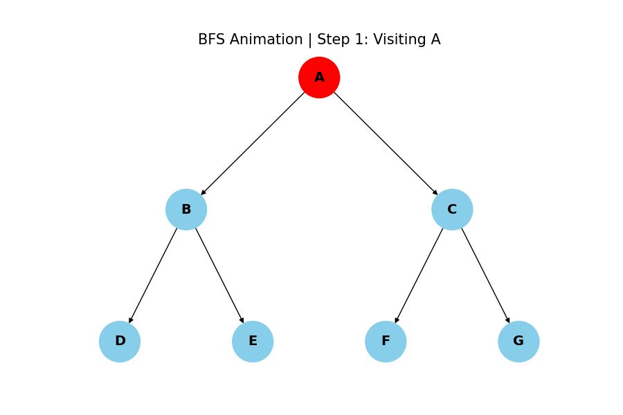
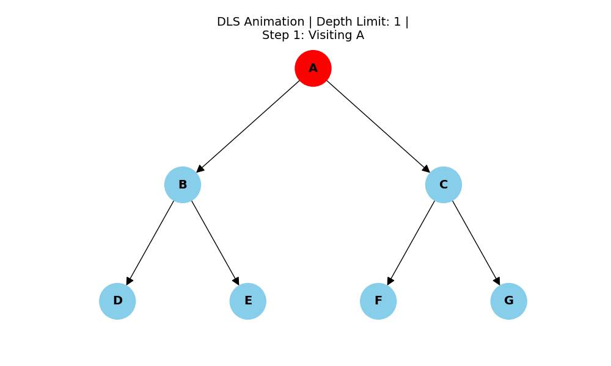
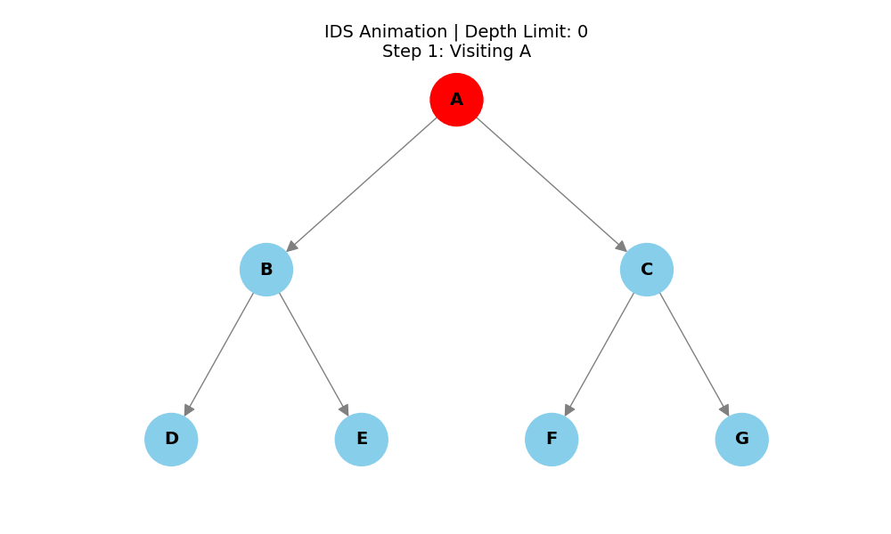
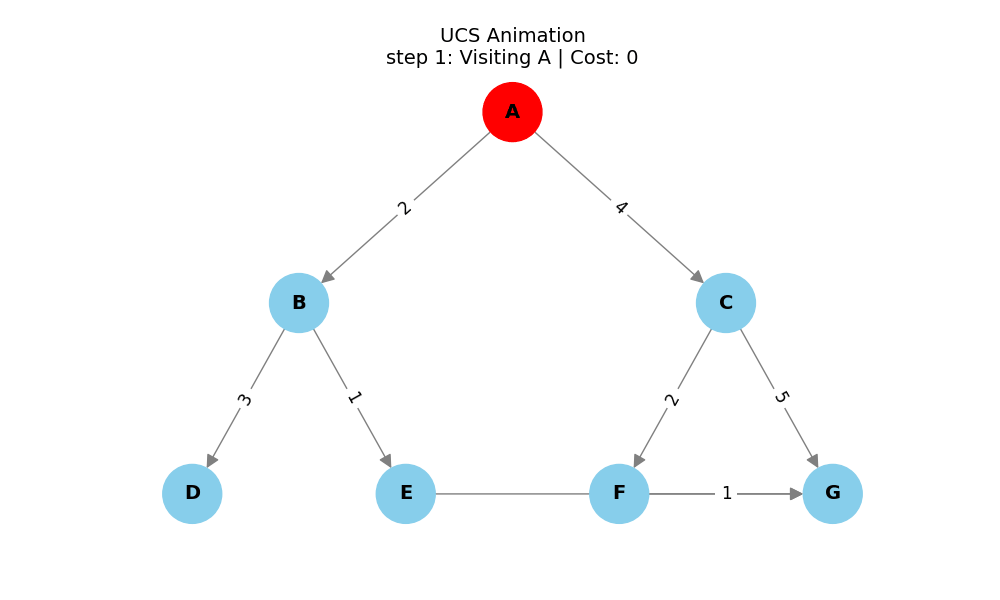

# Algorithms
1. Breadth-First Search (BFS)
2. Depth-First Search (DFS)
3. Depth-Limited Search (DLS)
4. Iterative Deepening DFS (IDDFS)
5. Uniform Cost Search (UCS)

## Programming Language
Python

## Tools
- Google Colab
- NetworkX
- Matplotlib

## Features
- Graph Visualization
- Animated Search Traversal
- Algorithm Implementation
- Traversal Output
## BFS Animated Visualization

## DFS Animation Visualization

## DLS Animation Visualization

## IDS Animation Visualization

## UCS Animation Visualization

